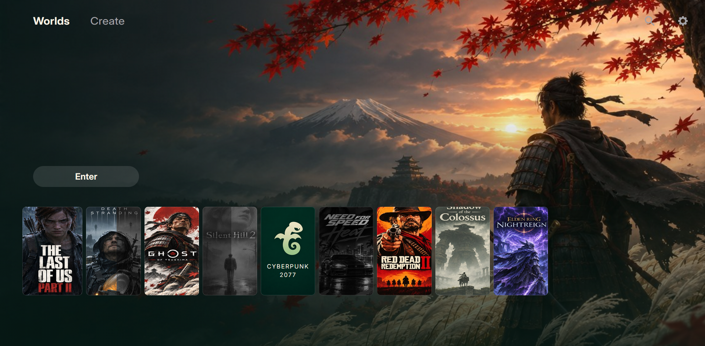

# TaleSide

**TaleSide** is an app in development for turning source material into persistent, interactive worlds.

> **Status:** Early development (World creation preview).

## Vision

Most AI roleplay breaks the moment you look outside the room you're standing in—everyone knows things they couldn't possibly know, time stands still until you type, and the world bends to whatever you say. **TaleSide** is being built to turn the original media you know into realities that live on their own, where people a country away keep moving, choosing, and crossing paths, with you and with one another.

**Whole worlds rebuilt from original media.** Instead of starting from blank prompts or hand-made character cards, you feed TaleSide the original stories themselves—books, fanfiction, companion guides, and eventually shows and films. Rather than skimming basic character trivia, it works to rebuild the entire setting and whatever rules or systems that particular universe runs on. Depending on the world you bring in, that can cover anything from places, factions, and historical events to local customs, power systems, or why aging, healing, and survival work differently for an immortal ruler than for an ordinary soldier. Even shorter stories can be expanded into full, consistent worlds that remain true to their source.

**One real world, and nobody shares a mind.** Characters never read from a shared script or learn facts just because they appeared in the last message. One world tracks what is actually true at any moment—where everyone stands, who can see or hear what, what actions physically succeed, and whatever else that setting depends on—without revealing secrets that nobody there could know. Each character experiences only what reaches them, interpreting it through their own memories, feelings, and beliefs. Imagine helping Naofumi buy supplies in Melromarc after Myne's accusations have ruined his reputation. Raphtalia remembers your kindness, but a merchant who witnesses the exchange tells the town guards you're working with the disgraced Shield Hero, and because of that, by morning, an innkeeper who once welcomed you refuses you a room. Or during Mobile Fortress Destroyer's attack on Axel, you leave your position to carry an injured adventurer to safety. Kazuma sees you save their life, while someone watching from the town walls sees only you running away. By the time you return to the Adventurers Guild, people you relied on have heard that you abandoned them. The person you rescued remembers a hero; others remember a coward.

**Hundreds or thousands of people living across the same map.** TaleSide is intended to carry that independence across dozens, hundreds, or even thousands of individuals, alongside groups and entire nations, all living through the same passing time. Imagine travelling across the Demon Continent with Rudeus, Eris, and Ruijerd. In Rikarisu, you help a boy Ruijerd rescued, convince a few adventurers that the feared Superd warrior saved his life. After you leave, the boy keeps telling his story. Merchants carry different versions of it toward Wind Port. Weeks later, you reach another city and find that some people are willing to hear Ruijerd out, while others refuse to let him through the gates. The same continues at Hogwarts while you're practising defensive spells with Harry in the Room of Requirement. Umbridge is questioning students elsewhere in the castle about it. One friend who promised to stand beside you receives a letter from their parents demanding they stay away from Harry. When you return for the next meeting, they are missing.

And none of this is staged. Harry, Umbridge, your missing friend, Ruijerd, Paul: none of them are lines of prose written by a single model. Each one is an independent agent with their own memories, goals, and beliefs, living in the world whether or not you ever meet them. What they do ripples outward. Their choices can shift prices and politics, a rumor about you can strain a relationship, and a bounty can be placed on your head on the far side of the world without you ever hearing of it. All of it is possible because these agents are always on: not static entities scripted in code, but living inhabitants who keep acting, and keep interacting with one another, whether you’re nearby or not or whether you have ever met them or not.

## Screenshot

## Quickstart

[Run TaleSide on Windows](./docs/quickstart.md).

## License

TaleSide’s source code is licensed under the **[PolyForm Shield License 1.0.0](./PolyForm%20Shield%201.0.0)**.

The **TaleSide** name, dragon logo/favicon, and custom artwork remain **All Rights Reserved**.

Required Notice: Copyright 2026 Vyce101 (https://github.com/Vyce101/TaleSide)
